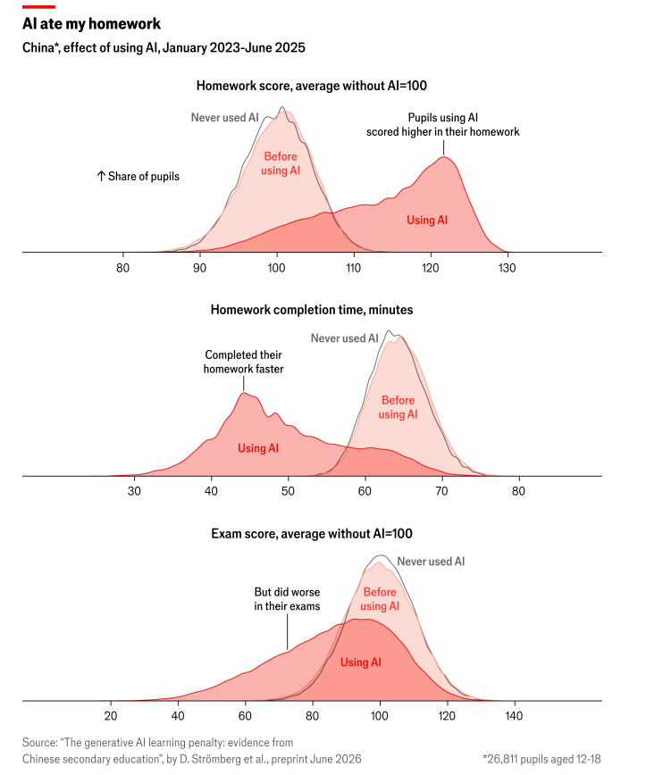

::: {.site .course-page}

<!-- ============ COURSE HEADER ============ -->
```{=html}
<div class="course-header">
  <div class="hero-name">Economics of Crime I</div>
  <p class="hero-eyebrow">EAE6089 · Graduate</p>
  <p class="hero-affil">Department of Economics, School of Economics, Business and Accounting (FEA-USP)</p>
  <p class="hero-sub">Danilo Souza · August 3 - October 11, 2026</p>
</div>
```
<br>

```{=html}
<div class="hero-links">
  <a href="https://drive.google.com/file/d/15lll-6lE1Xgj-MZZetZIUNHMqsRkrPo3/view?usp=sharing">Lecture Plan and Reading List</a>
  <a href="https://drive.google.com/file/d/1uFEyCxLB5dRCG_-mF1TCtjjKR6HH8xIQ/view?usp=sharing">Referee Report List</a>
  <a href="https://calendly.com/danilo_souza/office_hours">Office hours</a>
  <a href="mailto:danilosouza@usp.br">Email</a>
  <a href="../index.html#teaching">← All courses</a>
</div>
```

<!-- ============ DESCRIPTION ============ -->
::: {#description .sec}
## Description

### Mission {.subhead}

This course prepares students to engage critically with the economics of crime, with an emphasis on empirical research that uses modern methods of causal identification. We cover the effects of policing, punishment, labor market conditions, and education on crime, as well as public policy in illegal markets and the dynamics of organized crime. Students will learn to assess the existing evidence, identify gaps in the literature, and design original projects with the potential for high-impact publication.

### Prerequisites {.subhead}

Students should be comfortable with microeconomic theory — in particular the analysis of market failures and welfare — and with modern methods of causal identification, including differences-in-differences, regression discontinuity, and instrumental variables. Prior coursework in econometrics is strongly recommended.

### Content summary {.subhead}

1. Motivation: data, the state of the field, and empirical challenges
2. The rational choice model: static and dynamics
3. Policing, enforcement, and discrimination
4. Incarceration, monitoring, and punishment
5. Labour market conditions and education
6. Organised crime: causes and consequences
7. Illegal markets and drugs

A detailed reading list for each topic is available above.
:::

<!-- ============ MEETINGS ============ -->
::: {#meetings .sec}
## Meetings

::: {.info-block}
- [Mondays and Wednesdays, 4:00--5:50 PM]{.info-value}
- [Room A-8, FEA I Building]{.info-value}
- [August 3 - October 11, 2026]{.info-value}
:::
:::

<!-- ============ ASSESSMENT ============ -->
::: {#assessment .sec}
## Assessment

Assessment has three components: (i) a referee report on an unpublished paper, (ii) a class presentation of a published paper, and (iii) an original research project on a topic related to the course, submitted as a 10–15 page paper and presented in class. The first two are worth 20% each; the project accounts for the remaining 60%.

### Key dates {.subhead}

::: {.info-block}
- [Referee report due on 11 September]{.info-value}
- [Research project presentations: 23 & 28 September]{.info-value}
- [Final research project due on 9 October]{.info-value}
:::

### Use of AI {.subhead}
AI tools are not prohibited, but they must not form the basis of your work: the analysis, the interpretation, and the ideas must be yours. This course follows the standards now set by academic publishers, and you are strongly encouraged to read both — they are short, and you will be held to them when you submit your own papers: [Elsevier](https://www.elsevier.com/about/policies-and-standards/generative-ai-policies-for-journals) and [Wiley](https://www.wiley.com/en-us/publish/article/ai-guidelines/#peerreview).

Every submission in which AI was used must close with a section titled *"Declaration of generative AI and AI-assisted technologies in the [referee report / manuscript] preparation process"*, stating exactly which tool was used and at which stages. Use the templates provided by either publisher. Basic spelling and grammar checks need not be declared.

When writing your referee report, **never upload the paper**, or any part of it, into an AI tool. An unpublished manuscript is a confidential document, and doing so may violate the authors' confidentiality and proprietary rights.

Don't get me wrong, AI is a remarkable tool, and it raises productivity on routine tasks — but leaning on it too heavily, at the expense of how we have traditionally studied and learned, may damage the learning process itself and erode our ability to recognize what we do not know. The evidence increasingly points in this direction. In the working paper [*"The Generative AI Learning Penalty: Evidence from Chinese Secondary Education"*](https://papers.ssrn.com/sol3/papers.cfm?abstract_id=6868618), Strömberg, Lei, and Wu track 26,811 students over 30 months and find that AI adoption raised homework productivity: scores rose by 18% while completion time fell by 30%. On the other hand, scores on closed-book exams, a common measure of learning outcome, decreased by 20% within six months. The losses are concentrated among the students whose short completion times and high homework scores indicate they had outsourced the work, while those who kept putting in the hours lost almost nothing. *The Economist* covered the paper [here](https://www.economist.com/graphic-detail/2026/08/18/does-ai-stop-children-from-learning). The figure below shows the size of the problem and the challenge that we will have to face in the coming years.

{#fig-ai width=800px max-width=100% fig-align="center"}
:::

<!-- ============ CONTACT ============ -->
::: {#course-contact .sec}
## Questions

Questions that come up during class are best resolved in class. For anything that remains, please come to office hours. Short questions — ones that fit in a few lines — can be sent by email with the subject line `EAE6089 — FirstnameLastname`. Beyond that, feel free to reach out in person or by email about anything else.
:::

[© 2026 Danilo Souza · [Back to homepage](../index.html)]{.footer-note}

:::
